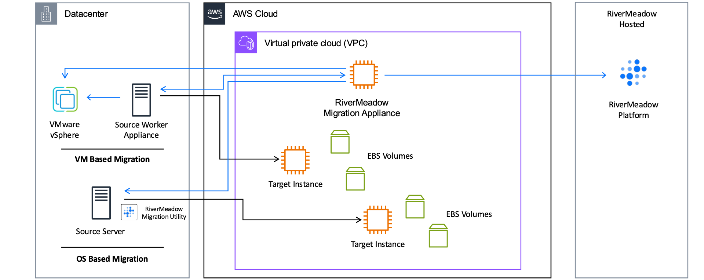
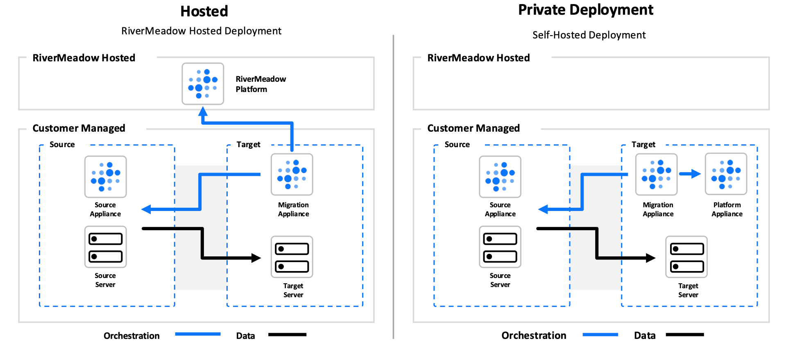

# Solution Architecture
---

**RiverMeadow Platform Architecture for AWS**

## Deployment Methods

The RiverMeadow platform supports two deployment methods. In both methods the migration appliance, source worker appliance, and migration utility are deployed into customer managed environments. The deployment methods differ in where the RiverMeadow platform (control plane) runs.

* **Hosted:** The RiverMeadow platform is hosted and managed by RiverMeadow. The migration appliance deployed in the target AWS account communicates with the hosted platform for migration orchestration. This is the most common deployment method and the one used throughout this course.
* **Private Deployment:** The RiverMeadow platform is self-hosted as a platform appliance in the customer managed target environment. The migration appliance communicates with the local platform appliance instead of the hosted platform.

## Solution Components

The following components (VM based or OS based) are utilized in migrations to AWS:

| Component | Description | Type | Location | Migration Method |
|:-----------:|:-------------:|:----------:|:----------:|:----------:|
| **Source Server** | The physical server, virtual machine, or cloud instance that will be migrated to AWS. Direct interaction with the source server occurs during OS based migrations. | Server | Source Environment | OS Based |
| **VMware vCenter** | The VMware vSphere management server that provides the REST API for platform interaction. Direct interaction with the vCenter server occurs during VM based migrations. | Virtual Machine | Source Environment | VM Based |
| **VMware ESXi** | The VMware vSphere virtualization host that hosts the vSphere virtual machines. Direct interaction with the ESXi host occurs during VM based migrations. | Hypervisor | Source Environment | VM Based |
| **RiverMeadow Platform** | The RiverMeadow hosted workload mobility platform. The platform provides the platform UI, REST API, migration orchestration, logging, and notifications. Interaction with the platform can be performed using the web interface (migrate.rivermeadow.com) or the platform REST API. | Hosted Platform | RiverMeadow Hosted | OS and VM Based |
| **RiverMeadow Migration Appliance** | A virtual appliance that is deployed into the target AWS account. The appliance brokers source and target machine configuration metadata used for orchestration and performs local migration orchestration operations in tandem with the RiverMeadow platform. | EC2 Instance | Target AWS Account | OS and VM Based |
| **RiverMeadow Source Worker Appliance** | A virtual appliance that is deployed into the source VMware vSphere cluster for VM based migrations. The source worker appliance is responsible for mounting virtual machine snapshots and transferring data to target workers. The appliance is automatically deployed into the source vSphere environment from the migration appliance. | VMware Virtual Machine | Source VMware vSphere | VM Based |
| **RiverMeadow Migration Utility** | A lightweight utility (less than 30 MB) that is deployed to source Windows or Linux systems to enable OS based migrations. The utility facilitates data transfer to the corresponding target worker (1:1 mapping) and enables the optimization and modernization capabilities of the platform. The utility does not require a reboot of the source system and can be automatically removed following the completion of the migration. | Utility | Source Server | OS Based |
| **RiverMeadow Target Worker** | A minimal image that is mounted on the target EC2 instance during the migration process (initial and delta). The target worker is responsible for transferring data from the source server or source worker appliance to the attached EBS volumes and preparing the system to run on Amazon EC2. It is only used during the migration process and removed before the finalization of the migration. | Boot Image (AMI) | Target AWS Account | OS and VM Based |