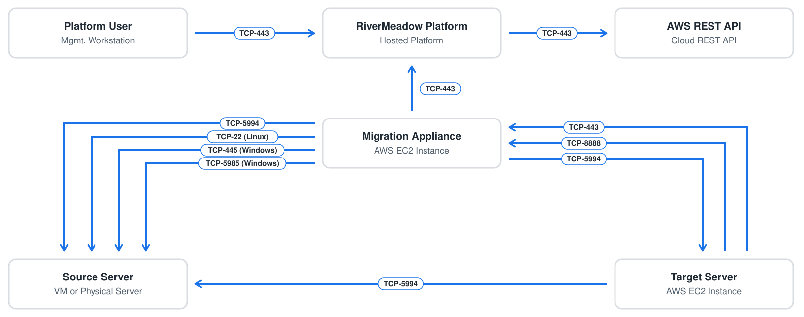
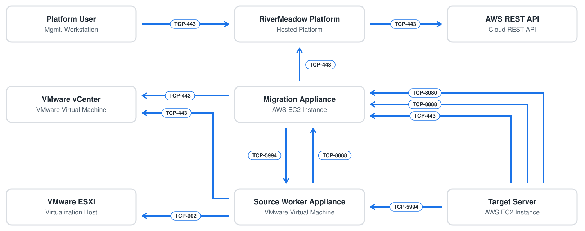

# Network Ports and Protocols
---

Network communication between the RiverMeadow solution components is critical to enable successful migrations to AWS. This section of the course details the network ports and protocols required for the different migration methods (VM based and OS based) available in the RiverMeadow platform.

## Platform Access

The hosted RiverMeadow portal acts as the user interface for managing migrations to AWS. The migration appliance is deployed to the target AWS account and initiates outbound communication to the RiverMeadow platform over 443/TCP to establish a bi-directional communication channel. This enables commands to be relayed to the migration appliance without the need to open inbound firewall ports in order to allow the RiverMeadow platform to reach the source or target environments. The RiverMeadow platform communicates with the AWS REST API over 443/TCP to automate operations in the target AWS account.

:::tip
For private deployments, the UI and API access and migration orchestration traffic is directed to the RiverMeadow platform appliance instead of the hosted RiverMeadow platform.
:::

## OS Based Migration Ports and Protocols

The following table details the network ports and protocols that must be opened to ensure proper network communication for OS based migrations.

| Source | Target | Port | Protocol | Notes |
|:--------:|:--------:|:-------:|:----------:|:-------:|
| Admin Workstation | RiverMeadow Platform | 443 | TCP | UI and API access for administrator management activities |
| RiverMeadow Migration Appliance | RiverMeadow Platform | 443 | TCP | Control plane communication for migration orchestration |
| RiverMeadow Migration Appliance | Source Server (Windows) | 5985 | TCP | Automated migration utility deployment for Windows (WinRM). ***This port is optional if the utility is preinstalled*** |
| RiverMeadow Migration Appliance | Source Server (Windows) | 445 | TCP | Automated migration utility deployment for Windows (SMB). ***This port is optional if the utility is preinstalled*** |
| RiverMeadow Migration Appliance | Source Server (Linux) | 22 | TCP | Automated migration utility deployment for Linux (SSH). ***This port is optional if the utility is preinstalled*** |
| RiverMeadow Migration Appliance | Source Server | 5994 | TCP | Source inspection to collect source server system metadata |
| RiverMeadow Migration Appliance | Target EC2 Instance (Linux) | 5994 | TCP | Control plane communication for migration orchestration |
| Target EC2 Instance | RiverMeadow Migration Appliance | 443 | TCP | Control plane communication for migration orchestration (message bus) |
| Target EC2 Instance | RiverMeadow Migration Appliance | 8888 | TCP | Control plane communication for migration orchestration (API access) |
| Target EC2 Instance | Source Server | 5994 | TCP | Data replication from the source server to the target instance |

## VM Based Migration Ports and Protocols

The following table details the network ports and protocols that must be opened to ensure proper network communication for VM based migrations.

| Source | Target | Port | Protocol | Notes |
|:--------:|:--------:|:-------:|:----------:|:-------:|
| Admin Workstation | RiverMeadow Platform | 443 | TCP | UI and API access for administrator management activities |
| RiverMeadow Migration Appliance | RiverMeadow Platform | 443 | TCP | Control plane communication for migration orchestration |
| RiverMeadow Migration Appliance | Source VMware vCenter Server | 443 | TCP | API access to the source VMware vCenter Server |
| RiverMeadow Migration Appliance | RiverMeadow Source Worker Appliance | 5994 | TCP | Control plane communication for migration orchestration |
| RiverMeadow Source Worker Appliance | RiverMeadow Migration Appliance | 8888 | TCP | Control plane communication for migration orchestration (API access) |
| RiverMeadow Source Worker Appliance | Source VMware vCenter Server | 443 | TCP | API access to the source VMware vCenter Server |
| RiverMeadow Source Worker Appliance | VMware ESXi Hosts | 902 | TCP | ESXi host data transfer (NBDSSL) |
| Target EC2 Instance | RiverMeadow Migration Appliance | 443 | TCP | Control plane communication for migration orchestration (message bus) |
| Target EC2 Instance | RiverMeadow Migration Appliance | 8888 | TCP | Control plane communication for migration orchestration (API access) |
| Target EC2 Instance | RiverMeadow Migration Appliance | 8080 | TCP | Control plane communication for migration orchestration (API access) |
| Target EC2 Instance | RiverMeadow Source Worker Appliance | 5994 | TCP | Data replication from the source worker appliance to the target instance |
