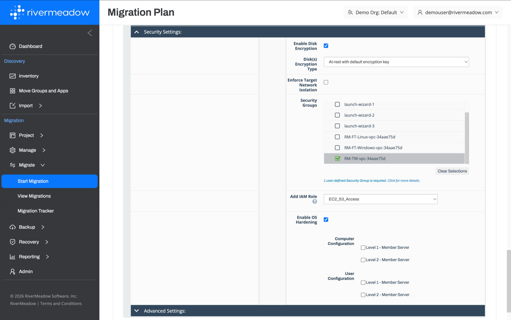

# Network Isolation
---

The RiverMeadow platform enables accelerated migration testing with no source impact. This capability requires that the target or clone instance is isolated with limited connectivity to the production network to prevent conflicts with the source server. The migrated target instance must have a routable IP address that is different than the IP address of the source server. This is used by the target instance to communicate with the RiverMeadow migration appliance and the source server or RiverMeadow source worker appliance to perform the migration operations.

Network isolation in AWS is simplified through the use of instance level security groups, which allow the traffic for each target EC2 instance to be restricted without changes to the broader network.

### Security Groups

Security groups are assigned to the target EC2 instance in the security settings of the migration profile. During the migration and testing phases, the security groups associated with the target instance should only allow the network ports and protocols required by the RiverMeadow platform.

* **Required Migration Traffic:** The RiverMeadow platform creates default security groups to allow the target instance to reach the RiverMeadow migration appliance and the source server or the source worker appliance using the ports detailed in the [Network Ports and Protocols](./05-network-ports-and-protocols.md) section.
* **Remote Access for UAT:** Additional security groups can be added to the instance in the migration profile to allow remote access to the instances for user acceptance testing prior to the cutover.
* **Restricted Network Access:** All other traffic should be blocked to ensure that the target instance cannot impact the production environment while the source server is still running.

:::info
During the cutover, the security groups used for isolation are replaced with the security groups that allow production traffic to the migrated instance.
:::
