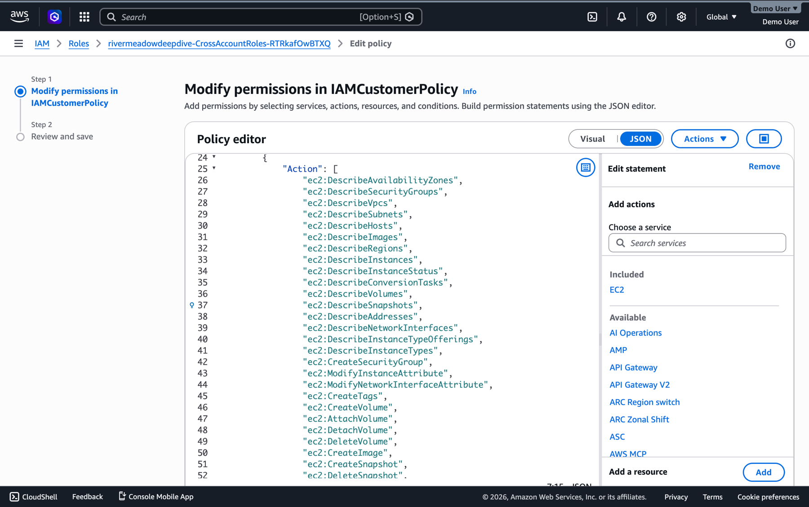
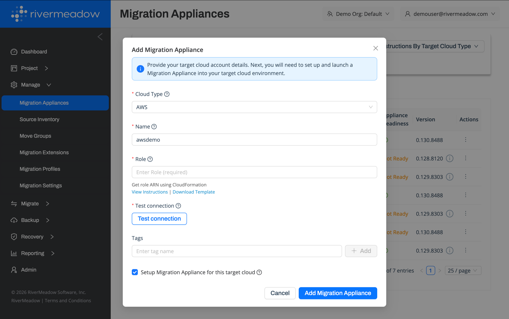
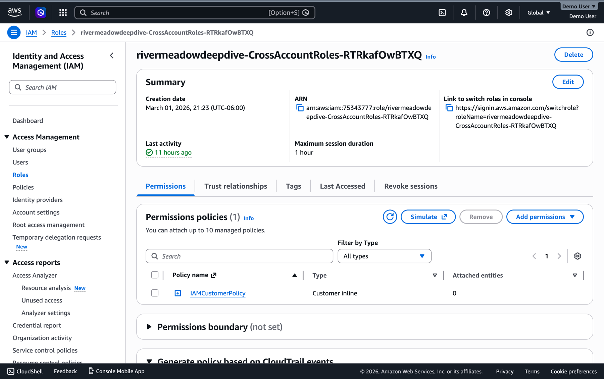
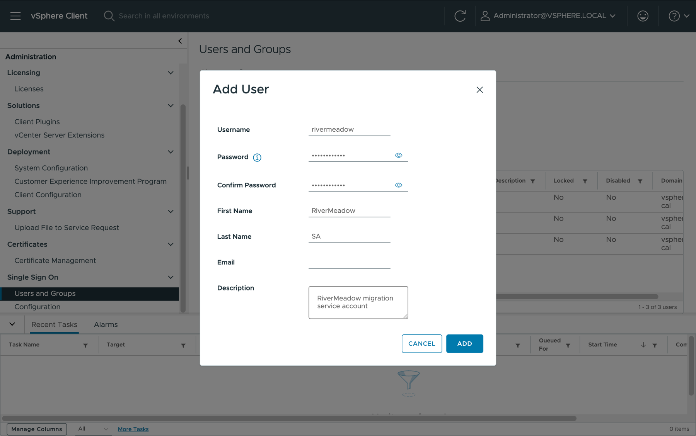

import Tabs from '@theme/Tabs';
import TabItem from '@theme/TabItem';

# Access Configuration
---

## AWS IAM Role

The RiverMeadow platform utilizes an AWS IAM role (cross-account role) with privileges in the target AWS account to automate the migration process. The security best practice is to grant the role only the privileges that are required to align with the security principle of least privilege.

### Role Permissions

* **Instance Management:** The role includes permissions to create and modify EC2 instances that are deployed during the migration process.
* **Security Group Management:** The role includes permissions to create and update security groups as well as attach and detach them from EC2 instances.
* **KMS Interaction:** The role includes permissions to list and describe KMS keys for EBS volume encryption.

### IAM Role Creation

The IAM role can be created using the CloudFormation template provided by the RiverMeadow platform, or manually using the AWS console or external automation.

<Tabs>
  <TabItem value="cloudformation" label="CloudFormation" default>

The RiverMeadow platform includes an AWS CloudFormation template that can be downloaded to automate the creation of the AWS IAM role used by the platform to integrate with the target AWS account. The template is available from the **Download Template** link when adding a migration appliance in the RiverMeadow portal.

  </TabItem>
  <TabItem value="manual" label="Manual or External Automation">

The AWS IAM role can be created manually or using other automation tooling such as Terraform, OpenTofu, Python, Ansible, or others to seamlessly integrate with existing processes. The following policy details the permissions required by the RiverMeadow platform.

  </TabItem>
</Tabs>

:::tip
The most current version of the required permissions is available in the RiverMeadow documentation: [https://docs.rivermeadow.com](https://docs.rivermeadow.com).
:::

## VMware vSphere Service Account (VM Based - Optional)

The RiverMeadow platform supports VM based migrations from VMware vSphere to AWS using a hypervisor-level integration. A service account with the necessary privileges to the source VMware vSphere environment is required for VM based migrations.

### Role Privileges

* **Appliance Deployment:** The service account requires privileges to provision the source worker appliance from the migration appliance.
* **Snapshot Management:** The service account requires privileges to create and manage snapshots for use during data replication.
* **Disk Management:** The service account requires privileges to attach and detach snapshot disks to and from the source worker appliance virtual machine.