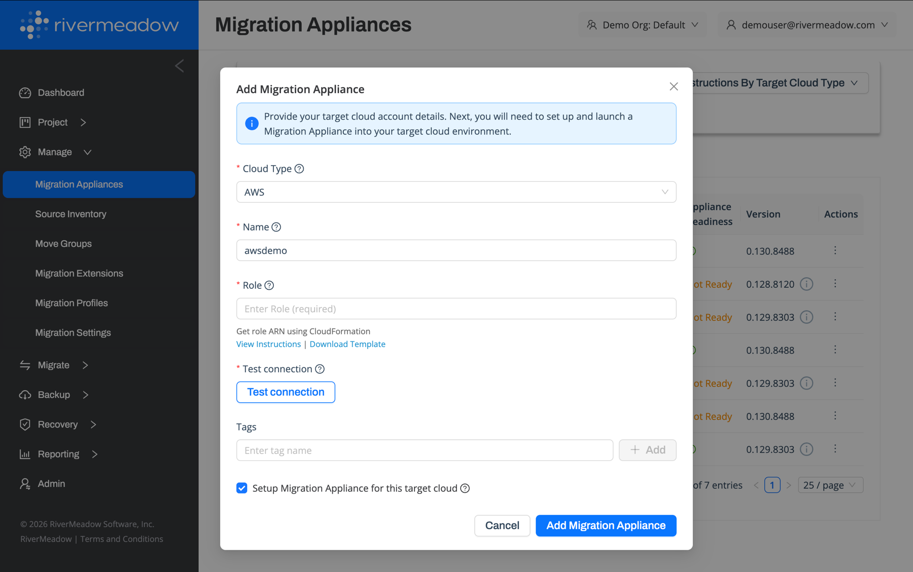
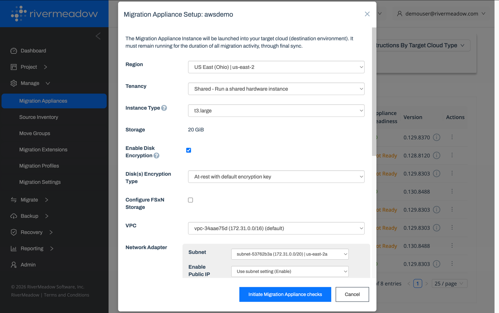

# Migration Appliance
---

The RiverMeadow migration appliance is a virtual appliance that is deployed as an EC2 instance into the target AWS account. The appliance brokers source and target machine configuration metadata used for orchestration. The migration appliance communicates with the RiverMeadow hosted platform using an outbound initiated connection over 443/TCP.

## AWS Cloud Integration Setup

The RiverMeadow cloud integration (cloud account) is used to integrate the platform with the target AWS account where servers will be migrated. The cloud integration is created when adding a migration appliance in the RiverMeadow portal.

| Name | Details |
|:------:|---------|
| **Cloud Type** | The type of target cloud. Select **AWS** for migrations to Amazon EC2. |
| **Name** | The name associated with the cloud integration that is used to designate where a source server will be migrated (i.e. - multiple AWS accounts or other targets such as ROSA, EVS, or NC2). |
| **Role** | The ARN of the [IAM role](./08-access-configuration.mdx) created to grant the RiverMeadow platform access to the target AWS account. |
| **Test Connection** | Validates that the RiverMeadow platform can assume the IAM role and access the target AWS account. |
| **Tags** | Optional RiverMeadow tags associated with the cloud integration. |
| **Setup Migration Appliance** | Whether to continue to the migration appliance deployment for this target cloud. |

## Migration Appliance Deployment

The deployment of the migration appliance is automated using the integration between the RiverMeadow platform and the target AWS account.

* **Instance Type:** The migration appliance is deployed using a t3.large EC2 instance into the desired AWS region.
* **Deployment Location:** The migration appliance can be deployed into any region or VPC in the AWS account if the network connectivity requirements are met.
* **RiverMeadow Platform Connection:** The migration appliance checks in with the RiverMeadow platform (443/TCP) once it has been deployed.

### Configuration Settings

The following settings are configured during the migration appliance deployment:

| Name | Details |
|:------:|---------|
| **Region** | The AWS region where the migration appliance will be deployed. |
| **Tenancy** | The EC2 tenancy for the migration appliance instance (shared or dedicated hardware). |
| **Instance Type** | The EC2 instance type for the migration appliance (t3.large). |
| **Enable Disk Encryption** | Whether to encrypt the EBS volume of the migration appliance. |
| **Disk Encryption Type** | The KMS key used to encrypt the EBS volume (default encryption key or a customer managed key). |
| **Configure FSxN Storage** | Whether to enable the Amazon FSx for NetApp ONTAP integration for migrated instances. |
| **VPC** | The VPC where the migration appliance will be deployed. |
| **Subnet** | The subnet where the migration appliance network interface will be deployed. |
| **Enable Public IP** | Whether to assign a public IP address to the migration appliance (or use the subnet setting). |

The migration appliance checks are initiated once the settings have been provided to validate the configuration prior to the deployment.

## Multiple Migration Appliance Use Cases
A single RiverMeadow migration appliance supports the majority of common use cases of server migrations to AWS. There are scenarios where additional migration appliances would need to be deployed to meet specific requirements.

* **Multiple AWS Accounts:** Each target AWS account is integrated with the RiverMeadow platform using a cloud integration. Migrating servers to multiple AWS accounts requires a cloud integration and migration appliance for each target account.
* **Granular Role Based Access Control:** The RiverMeadow platform supports granular access control through the use of organizations and projects. A RiverMeadow migration appliance can only be tied to a single project within the RiverMeadow platform. If user access is segregated through the use of projects, then a migration appliance needs to be deployed for each project.
