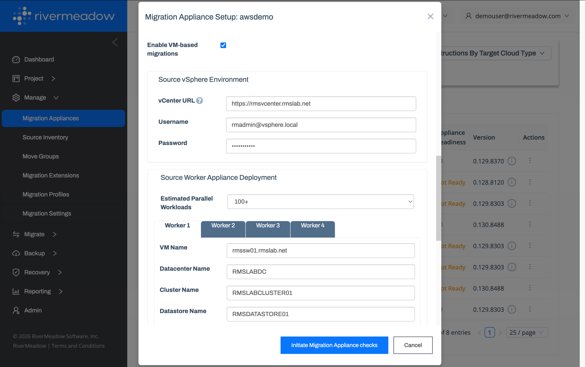

# Source Worker Appliance
---

The source worker appliance is an optional component that is deployed for VM based migrations from VMware vSphere source environments. The deployment of the source worker appliance is automated by the migration appliance deployed to the target AWS account. The appliance is responsible for mounting virtual machine snapshots and transferring the data to the target workers.

## Hardware Requirements
The source worker appliance requires the following resources on the source VMware vSphere environment:

* **CPU:** 4 vCPU
* **Memory:** 16 GB
* **Disk Space:** 30 GB

## Configuration Settings

The following settings are configured during the migration appliance setup when VM based migrations are enabled.

| Name | Details |
|:------:|:------------------:|
| **Enable VM-based Migrations** | Whether to enable VM based migrations for the migration appliance |
| **vCenter URL** | The URL of the source VMware vCenter server |
| **Username** | The username of the [vSphere service account](./08-access-configuration.mdx) used to authenticate to the source VMware vCenter server |
| **Password** | The password of the vSphere service account used to authenticate to the source VMware vCenter server |
| **Estimated Parallel Workloads** | The number of virtual machines expected to be migrated concurrently, used to size the source worker appliance deployment |
| **VM Name** | The virtual machine name used for the source worker appliance in the source VMware environment |
| **Datacenter Name** | The name of the vSphere datacenter where the source worker appliance will be deployed |
| **Cluster Name** | The name of the vSphere cluster where the source worker appliance will be deployed |
| **Datastore Name** | The name of the vSphere datastore where the source worker appliance will be deployed |

## Multiple Appliances

Multiple source worker appliances can be deployed in a scale-out fashion to handle a larger number of concurrent server migrations. Each source worker appliance is configured on its own tab (Worker 1, Worker 2, etc.) during the migration appliance setup.
