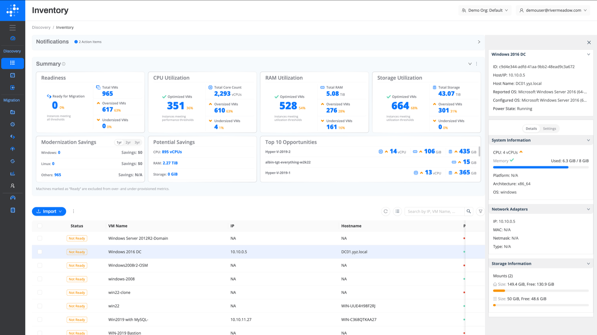
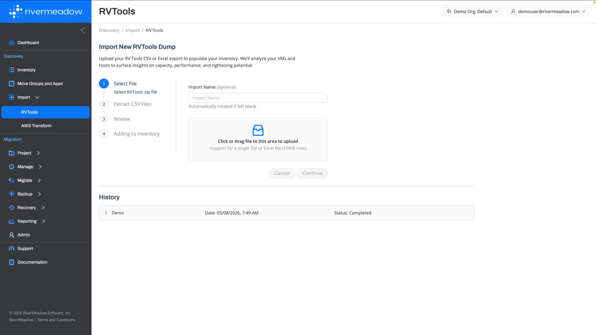
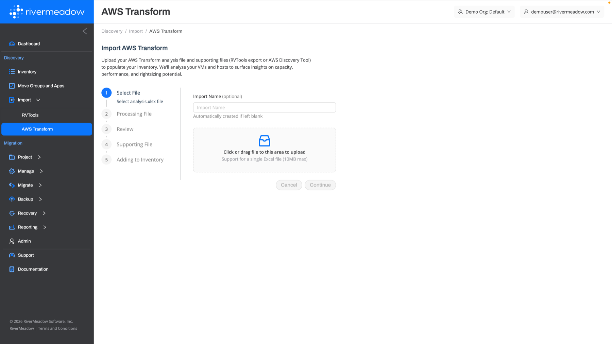
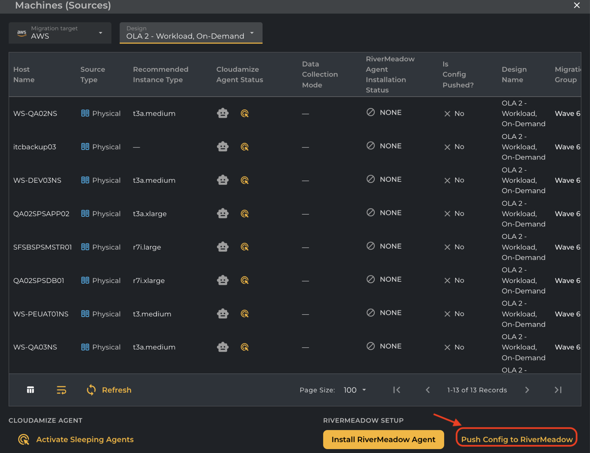

# Discovery
---

The RiverMeadow platform includes a native discovery capability that provides an inventory of the source environment along with insights into migration readiness, resource utilization, and potential savings. The discovery inventory can be populated natively or by importing the output of third-party discovery and assessment tools.

## Inventory Insights

The discovery inventory summarizes the source environment to help plan migrations to AWS.

* **Readiness:** The number of virtual machines that are ready for migration based on the configured thresholds.
* **CPU, RAM, and Storage Utilization:** The number of optimized, oversized, and undersized virtual machines based on utilization thresholds, used to inform rightsizing during the migration.
* **Modernization Savings:** The estimated savings from modernizing Windows and Linux operating systems.
* **Potential Savings:** The CPU, RAM, and storage that can be reclaimed by rightsizing oversized virtual machines.
* **Top Opportunities:** The virtual machines with the largest rightsizing opportunities.

## Inventory Import

The RiverMeadow platform supports importing the output of common discovery tools to populate the platform's native discovery capability.

### RVTools Import

The RiverMeadow platform supports ingesting the output of RVTools (CSV or Excel export) to populate the discovery inventory with the virtual machines and hosts from a VMware vSphere environment.

### AWS Transform Import

The RiverMeadow platform supports ingesting the output of AWS Transform to populate the discovery inventory. The AWS Transform analysis file is uploaded along with its supporting files (an RVTools export or AWS Discovery Tool output).

:::tip
Explore the [RiverMeadow AWS Transform Integration interactive demo](https://rivermeadow.storylane.io/demo/ypbalenv94tc) to see the AWS Transform import in action.
:::

## Cloudamize Integration

The RiverMeadow platform includes an integration with Cloudamize to enable rapid migration following the discovery and assessment phase.

* **Automated Agent Deployment:** Automate the deployment of the RiverMeadow migration utility directly from Cloudamize.
* **Wave Planning Sync:** Automate the creation and population of RiverMeadow move groups (waves) from Cloudamize with the push of a button.
* **Instance Type Recommendation Sync:** Recommended instance types from Cloudamize can be automatically synced to RiverMeadow.

