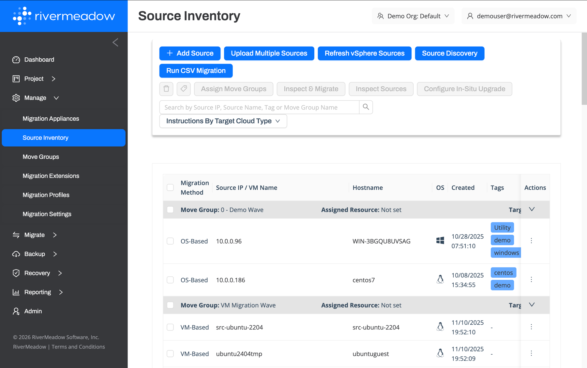
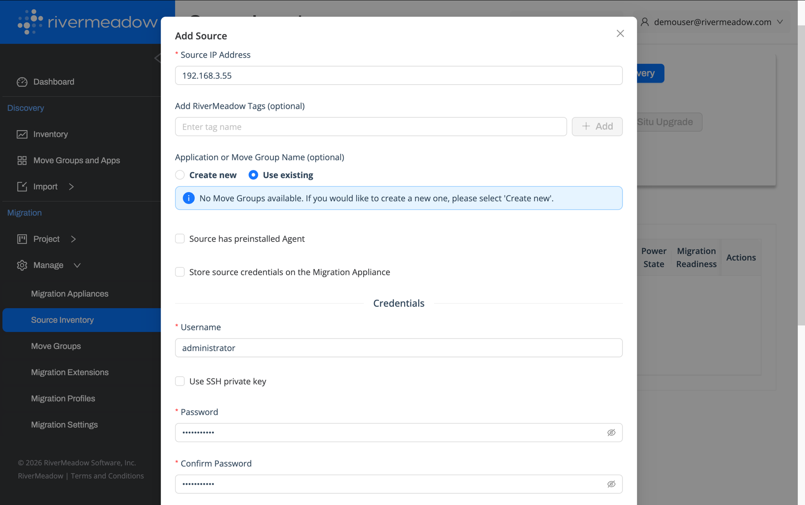

import Tabs from '@theme/Tabs';
import TabItem from '@theme/TabItem';

# Adding Source Servers
---
Once the RiverMeadow infrastructure components have been deployed to the source and target environments, the source servers that will be migrated need to be added to the source inventory in the RiverMeadow platform.

Adding source servers to the RiverMeadow source inventory can be performed using the following methods:

* **RiverMeadow UI:** Source servers for OS based migrations can be added manually using the RiverMeadow portal.
* **CSV Upload:** Source servers for OS based migrations can be added in bulk by uploading a CSV file via the RiverMeadow portal.
* **VMware vSphere Discovery:** Source servers for VM based migrations are added dynamically via the RiverMeadow integration with the source VMware vCenter using the vSphere REST API.
* **REST API:** Source servers for OS based migrations can be added in bulk in a programmatic fashion using the RiverMeadow REST API.

<Tabs>
  <TabItem value="ui" label="UI" default>
## RiverMeadow UI
For OS based migrations, source servers can be individually added to the source inventory using the RiverMeadow web portal.

| Field | Description |
| --- | --- |
| **Source IP Address** | The IP Address of the source server. This IP address must be reachable from the RiverMeadow migration appliance and the target EC2 instance. |
| **Tags** | RiverMeadow tags associated with the inventoried source server for organization or filtering purposes. |
| **Move Group** | The RiverMeadow move group to assign the source server to within the inventory. |
| **Pre-Installed Agent** | Whether the RiverMeadow migration utility has already been deployed to the source server using a method separate from the automated migration utility deployment performed by the RiverMeadow platform. |
| **Store Source Credentials** | Whether to store the credentials utilized to authenticate to the source server on the migration appliance or not. |
| **Username (Optional)** | The username of the user account used to automate the deployment of the RiverMeadow migration utility on the source server. |
| **Private Key (Optional)** | The SSH private key of the user account used to automate the deployment of the RiverMeadow migration utility to the source server. |
| **Password (Optional)** | The password of the user account used to automate the deployment of the RiverMeadow migration utility to the source server. |
| **Domain (Optional)** | The domain associated with the user account used to automate the deployment of the RiverMeadow migration utility to the source server. |

:::info
RiverMeadow tags are used only by the platform and are not applied to the source or target servers.
:::

  </TabItem>
  <TabItem value="csv" label="CSV">

    ## CSV Upload
    Source servers can be added in bulk using a Comma Separated Value (CSV) file.

    **Reference Fields**

    The following table details the supported fields for a CSV upload:

    |Name|Description|Required|
    |:----:|:-----------:|:------:|
    |**host**    | The IP Address of the source server. This IP address must be reachable from the RiverMeadow migration appliance and the target EC2 instance. | Yes |
    |**username**    | The username of the user account used to automate the deployment of the RiverMeadow migration utility on the source server. | No |
    |**password**| The password of the user account used to automate the deployment of the RiverMeadow migration utility to the source server. | No |
    |**private_key**| The SSH private key of the user account used to automate the deployment of the RiverMeadow migration utility to the source server. | No |
    |**agent**| Whether or not the RMS agent is pre-installed. "yes" = pre-installed RMS agent; "no" = the RMS agent is deployed by the platform. | Yes |
    |**domain**| The domain associated with the user account used to automate the deployment of the RiverMeadow migration utility to the source server. | No |
    |**move_group_name**| The RiverMeadow move group to assign the source server to within the inventory. | No |
    |**target_migration_date**| The target date for the server to be migrated within the RiverMeadow platform | No |
    |**assigned_resource_email**| The email address for the person assigned to the move group | No |
    |**cloud_sizing** | The target cloud and the size of the instance to be created for the source on the target cloud | No |
    |**tags**| The RiverMeadow tags to associate with the inventory record in the RiverMeadow platform | No |

  </TabItem>
  <TabItem value="vsphere" label="vSphere">

    ## VMware vSphere Discovery
    Source servers migrated using the VM based migration method are added dynamically via the vSphere integration configured on the migration appliance. The **Refresh vSphere Sources** action in the source inventory updates the list of virtual machines from the source vCenter server.

  </TabItem>
</Tabs>

## Move Groups

Imported servers can be moved into a group (wave, application group, sprint, etc.) to migrate multiple servers at the same time.
