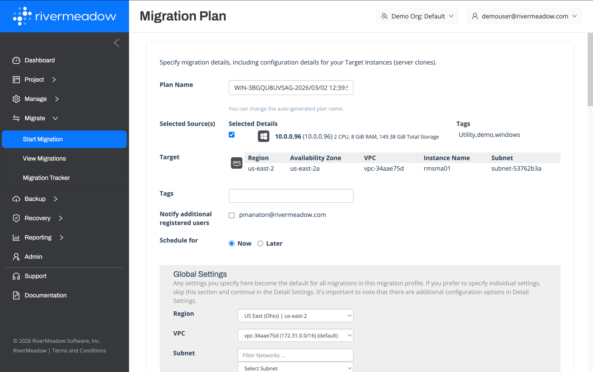
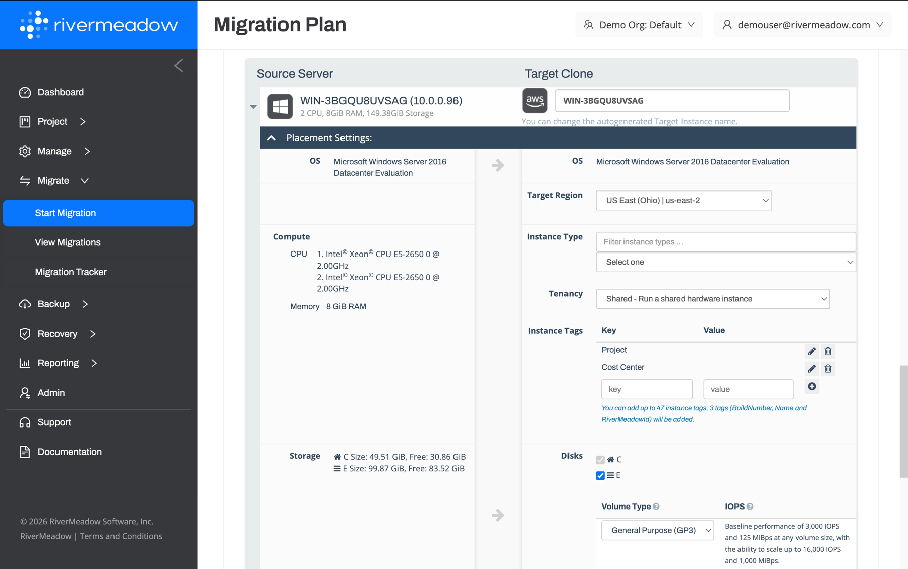
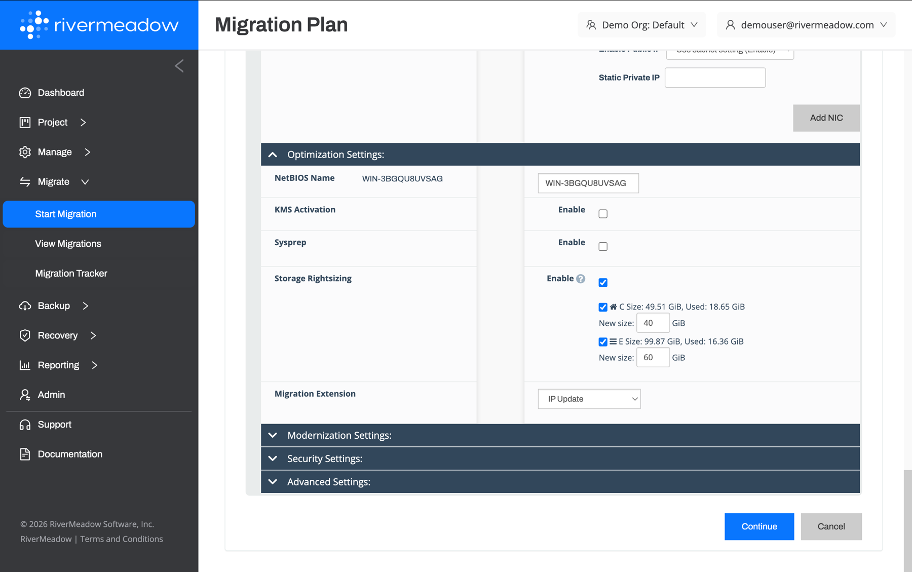
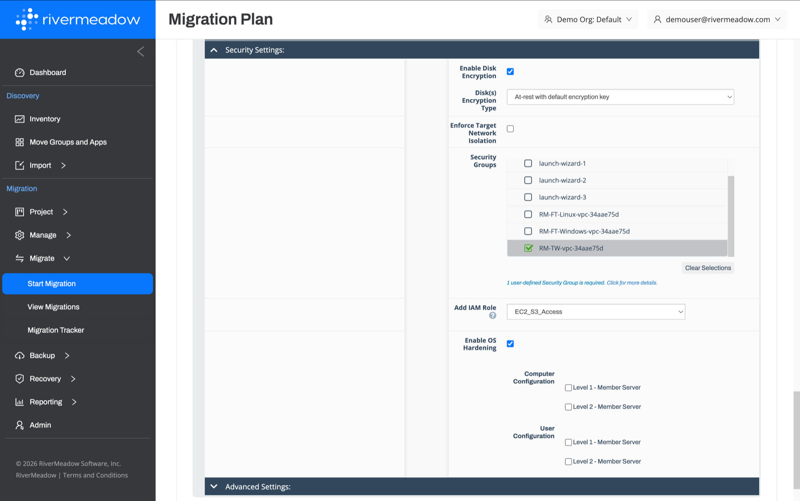
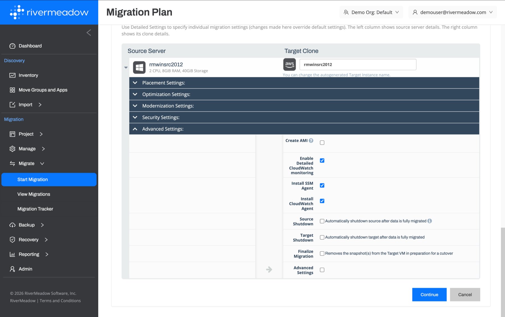
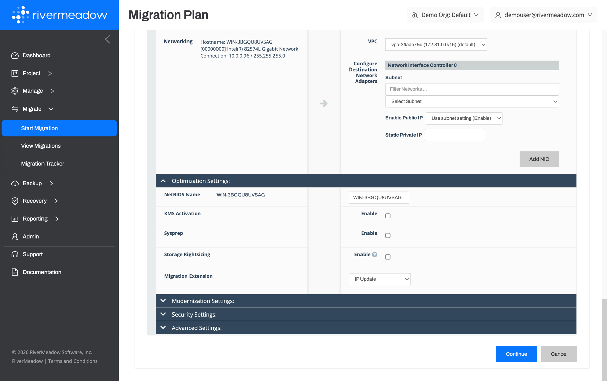
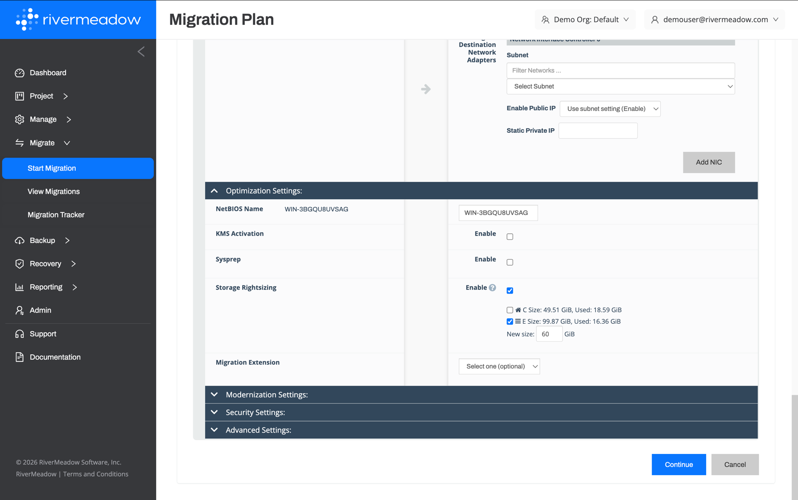

# Initial Migration
---
The initial migration of a server creates a new EC2 instance in the target AWS account and replicates the data from the source server to the attached EBS volumes. Once the initial migration or sync completes, initial testing and validation of the instance can be performed as a "smoke" test to check basic functionality.

## Migration Profile
The migration profile defines the plan for how the server(s) will be migrated, optimized, and/or modernized.

* **Scheduling:** The migration can be started immediately or scheduled for a future date and time to enable the initial sync to be performed during off-hours.
* **Bulk Migrations:** Migration profiles can be created using the UI, a CSV file, and the REST API.
* **Notifications:** Email notifications on the migration status can be configured in the migration profile.
* **Global Settings:** Settings specified in the global settings section become the default for all migrations in the migration profile. Individual settings can be overridden per server in the detailed settings.

### Server Settings

The migration profile defines the configuration details for how each server will be migrated, optimized, and/or modernized to AWS. The settings are organized into the following sections.

  
**Placement Settings**

The placement settings within the migration profile define the AWS configuration of the target EC2 instance.

| Name | Description | Supported Migration Methods |
|:------:|:-------------:|:--------:|
| **Target Region** | The AWS region where the target EC2 instance will be created | OS, VM |
| **Instance Type** | The EC2 instance type used for the target EC2 instance | OS, VM |
| **Tenancy** | The EC2 tenancy (shared or dedicated hardware) for the target EC2 instance | OS, VM |
| **Instance Tags** | The tags to apply to the target EC2 instance | OS, VM |
| **Disks** | The source disks or volumes to migrate to the target EC2 instance | OS, VM |
| **Volume Type and IOPS** | The EBS volume type (i.e. - gp3) and performance settings for the target EBS volumes | OS, VM |
| **VPC** | The VPC where the target EC2 instance will be created | OS, VM |
| **Subnet** | The subnet that the network interface(s) attached to the target EC2 instance will be associated with | OS, VM |
| **Enable Public IP** | Whether to assign a public IP address to the target EC2 instance (or use the subnet setting) | OS, VM |
| **Static Private IP** | An optional static private IP address for the network interface of the target EC2 instance | OS, VM |
| **Add NIC** | Add additional network interfaces to the target EC2 instance | OS, VM |

  
**Optimization Settings**

The optimization settings within the migration profile are used to configure storage rightsizing, migration extensions, and Windows settings.

| Name | Description | Supported Migration Methods |
|:------:|:-------------:|:--------:|
| **NetBIOS Name (Windows Only)** | The new NetBIOS name for the migrated Windows server | OS |
| **KMS Activation (Windows Only)** | Whether to activate Windows using Key Management Service (KMS) activation | OS |
| **Sysprep (Windows Only)** | Whether to sysprep the Windows system during the migration | OS |
| **Storage Rightsizing** | The desired size for the volumes or partitions being migrated to shrink or grow the volume or partition | OS |
| **Migration Extension** | The migration extension used to perform post-migration automation | OS, VM |

  
**Modernization Settings**

The modernization settings within the migration profile are used to configure OS modernization, SQL modernization, and Linux OS conversion.

| Name | Description | Supported Migration Methods |
|:------:|:------:|:-----------------:|
| **OS Modernization** | The operating system version to upgrade the target system to during the migration, or the Linux distribution to convert the target system to | OS |
| **SQL Modernization (Windows Only)** | The Microsoft SQL Server version to upgrade SQL Server to during the server migration | OS |

  
**Security Settings**

The security settings within the migration profile are used to configure security related settings such as encryption and security groups.

| Name | Description | Supported Migration Methods |
|:------:|:-------------:|:--------:|
| **Enable Disk Encryption** | Whether to encrypt the EBS volumes of the target EC2 instance, and the KMS key used for encryption | OS, VM |
| **Enforce Target Network Isolation** | Whether to enforce network isolation for the target EC2 instance during the migration | OS, VM |
| **Security Groups** | The security groups to assign to the target EC2 instance | OS, VM |
| **IAM Role** | The AWS IAM role (instance profile) to assign to the target EC2 instance | OS, VM |
| **Enable OS Hardening** | Whether to apply CIS hardening to Windows Server and RHEL servers during the migration | OS |

  
**Advanced Settings**

The advanced settings within the migration profile are used to configure AWS agent installation, source and target power management, and more.

| Name | Description |
|:------:|:-------------:|
| **Create AMI** | Whether to create an Amazon Machine Image (AMI) of the migrated instance |
| **Enable Detailed CloudWatch Monitoring** | Whether to enable detailed CloudWatch monitoring for the target EC2 instance |
| **Install SSM Agent** | Whether to install the AWS Systems Manager agent on the target EC2 instance using native automation |
| **Install CloudWatch Agent** | Whether to install the Amazon CloudWatch agent on the target EC2 instance using native automation |
| **Source Shutdown** | Whether to automatically shut down the source server after the data is fully migrated |
| **Target Shutdown** | Whether to automatically shut down the target EC2 instance after the data is fully migrated |
| **Finalize Migration** | Whether to remove the snapshot(s) from the target instance in preparation for a cutover |

## Migration Extensions

Migration extensions enable the execution of custom post-migration automation to automate common migration tasks.

* **Supported Automation Types:** Migration extensions can be Bash or Batch scripts that are executed on the target instance.
* **Execution Stages:** The migration extension can be executed at different stages of the migration and modernization process.
* **Command Arguments:** Supply server specific arguments to the script execution to individualize the execution.
* **Extension Expiration:** Migration extensions by default expire after 30 days from the date of the upload but can be extended.

## Storage Rightsizing

The storage rightsizing feature enables the ability to shrink or grow a storage volume or disk during the server migration.

* **Per Volume/Disk Setting:** The rightsizing can be configured at an individual volume or disk level to allow for granular configurations.
* **Target Disk Configuration:** The rightsizing feature creates a new disk or volume at the size configured during the migration process and transfers data using file-based replication.

## CSV Bulk Migration

Migration profiles can also be created using a CSV file to automate the scheduling of bulk migration waves. The platform includes support for exporting a migration profile to a CSV during the profile creation process via the UI to accelerate the CSV file creation process.

The CSV file includes columns such as the source IP, source hostname, OS type, migration type, migration method, scheduled time, target VM name, instance type, volume type, IOPS, EBS encryption, KMS key, partitions, transfer method, and partition resizing.
