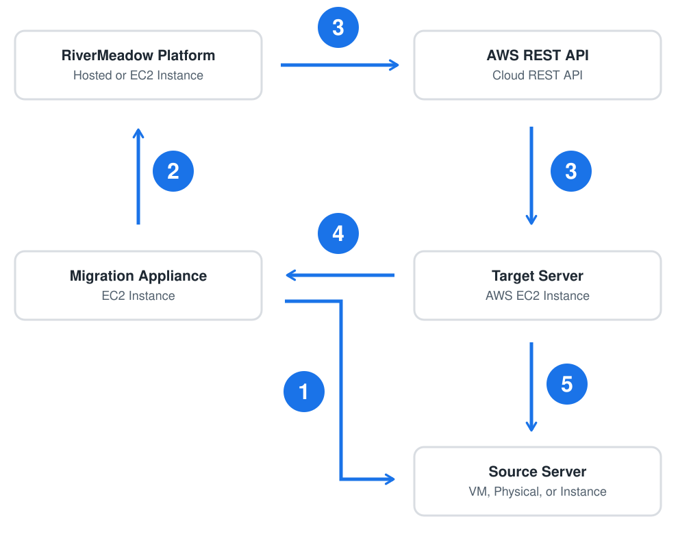
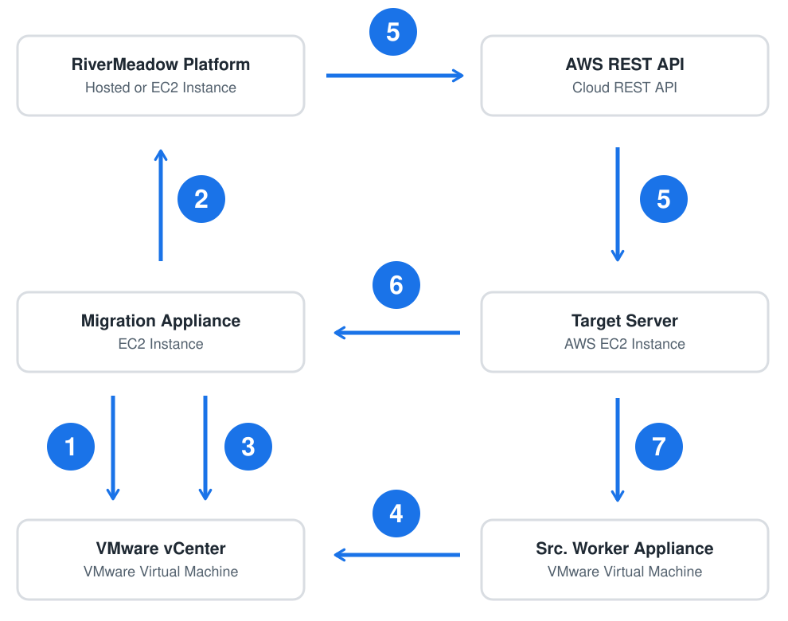

# Initial Migration Sequence
---
The RiverMeadow platform enables the migration of servers from various sources to AWS in an automated fashion. The platform orchestrates dozens of steps to coordinate the migration. This section of the course details the high-level steps that are performed during an initial migration or sync to Amazon EC2.

## OS Based Migrations

The following steps are performed during the initial migration of the server to Amazon EC2 for OS based migrations.

| Step | Action | Details |
|:---------:|:---------:|:--------:|
| **1** | **Source Server Inspection** | The migration appliance connects to the migration utility running on the source server (5994/TCP) to inspect the source server and collect system attributes. |
| **2** | **Upload Source Attributes** | The source server attributes are uploaded to the RiverMeadow platform and evaluated by the preflight migration checks to determine the migration readiness. |
| **3** | **Create Target EC2 Instance** | The RiverMeadow platform calls the AWS REST API to instantiate a new EC2 instance from the RiverMeadow target worker AMI based on the configuration defined in the migration profile. |
| **4** | **Target Worker Instructions** | The target worker running on the new EC2 instance communicates with the migration appliance (443/TCP and 8888/TCP) for instructions. |
| **5** | **Replicate Source Data** | The target worker communicates with the migration utility on the source server (5994/TCP) to start the data replication. The target worker writes the data replicated from the source server to the attached EBS volumes and prepares the system to boot on Amazon EC2. |

## VM Based Migrations

The following steps are performed during the initial migration of the server to Amazon EC2 for VM based migrations.

| Step | Action | Details |
|:---------:|:-----------------:|:--------:|
| **1** | **Source VM Inspection** | The migration appliance connects to the source vCenter server REST API (443/TCP) to collect the source virtual machine attributes. |
| **2** | **Upload Source Attributes** | The source virtual machine attributes are uploaded to the RiverMeadow platform and evaluated by the preflight migration checks to determine the migration readiness. |
| **3** | **Create Source VM Snapshot** | The migration appliance connects to the source vCenter server REST API and initiates a snapshot of the source virtual machine. |
| **4** | **Read Snapshot Data** | The source worker appliance connects to the ESXi hosts (902/TCP) to read the data from the source virtual machine snapshot. |
| **5** | **Create Target EC2 Instance** | The RiverMeadow platform calls the AWS REST API to instantiate a new EC2 instance from the RiverMeadow target worker AMI based on the configuration defined in the migration profile. |
| **6** | **Target Worker Instructions** | The target worker running on the new EC2 instance communicates with the migration appliance for instructions. |
| **7** | **Replicate Source Data** | The target worker communicates with the source worker appliance (5994/TCP) to start the data replication. The target worker writes the data replicated from the source worker appliance to the attached EBS volumes and prepares the system to boot on Amazon EC2. |
