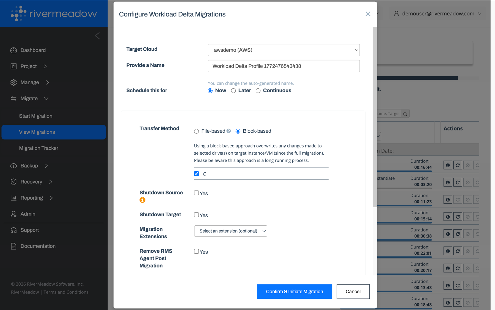

# Delta Migrations
---
Delta or incremental migrations are used to sync data changes between the source server and the target EC2 instance after the initial migration. Delta migrations are commonly performed multiple days leading up to the cutover event to minimize the delta between the source server and target instance.

## Sync Interval
The replication or sync schedule for the delta migrations can be adjusted to align with the rate of data change on the source server to reduce the amount of time required during the final delta migration. The amount of unsynced data is a major factor in the amount of time the server is offline during the change window.

* **Now (Ad-hoc):** Delta migrations can be configured to execute on-demand. This option is used during a change window to force a final sync of changes from the source server to the target instance.
* **Later (Scheduled):** Schedule a delta migration or migrations for a date and time in the future. The schedule supports the ability to configure delta migrations on multiple days to support daily or nightly data syncs.
* **Continuous:** Continuously sync changes from the source server to the target EC2 instance. The sync interval enables approximately a 5-minute lag between the source server and the instance in AWS.

## Transfer Method
* **File-based:** Changed files are copied from the source server to the target instance.
* **Block-based:** Changed blocks on the selected drives are copied from the source server to the target instance, overwriting any changes made to the selected drives on the target instance since the full migration. Block-based transfers can be a long-running process.

## Additional Options
Additional options or settings are available during a delta migration to enable additional automation or align with a "final" migration that is performed during the migration cutover.

* **Migration Extension:** Custom post-migration automation can be executed during incremental delta migrations or during the final delta migration to prepare the system for AWS.
* **Shutdown Source:** The RiverMeadow platform supports the ability to automatically power off the source server as part of the cutover process.
* **Shutdown Target:** The target EC2 instance can be automatically shut down after the delta migration completes.
* **Remove RMS Agent:** The RiverMeadow migration utility can be automatically removed following the completion of the final delta migration in the case of OS based migrations.
* **Finalize Migration:** In the case of the "final" delta migration, finalization operations such as removing target snapshots can be performed in preparation for the cutover.
